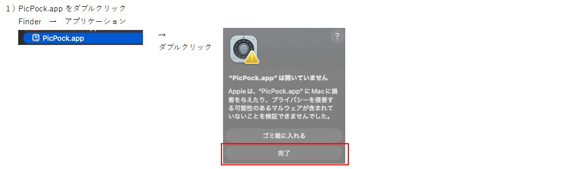
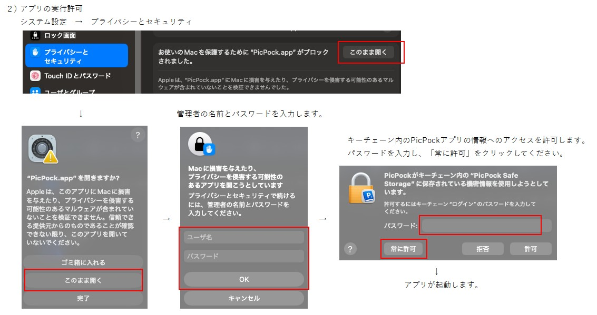
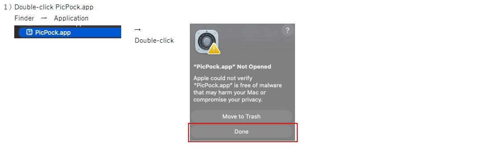
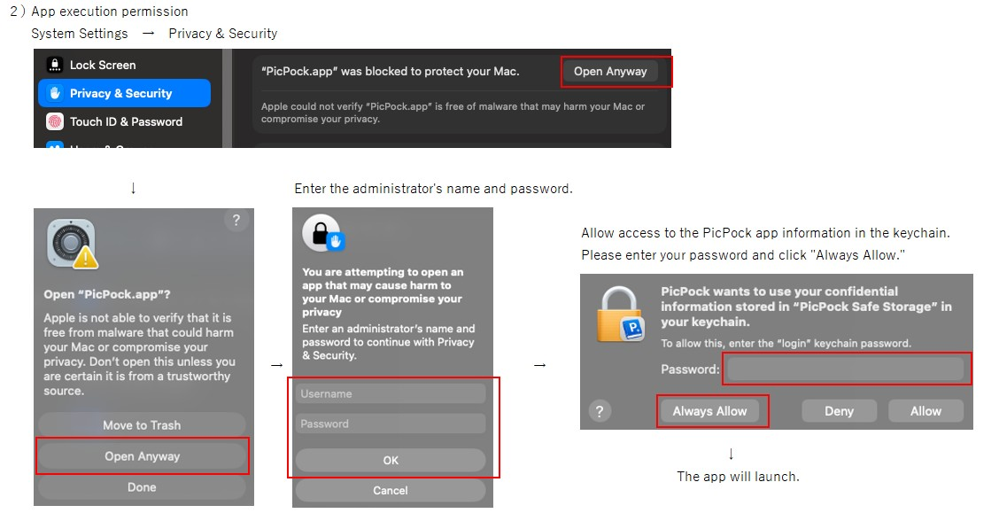

# Install PicPock on Mac (macOS 15 Sequoia or later)
### [日本語](#japanese) | [English](#english) 

## ＜日本語＞

### インストール
1. インストーラーをダウンロードして実行してください。

2. 本アプリは個人開発のためデジタル署名を行っておらず、インストール時に「開発元を検証できません」という警告が表示されます。
以下の手順でインストールを進めてください。

---

### アンインストール
- OS標準のアプリの削除画面からアンインストールを実行してください。

## ＜English＞

### Installation
1. Download and open the installer.

2. Since this app is not digitally signed, a warning stating "App cannot be opened because the developer cannot be verified" will appear. You can proceed with these steps.

---

### Uninstallation
Use the standard OS application removal process.

---

### [👉 TOP Page](./README.md)

