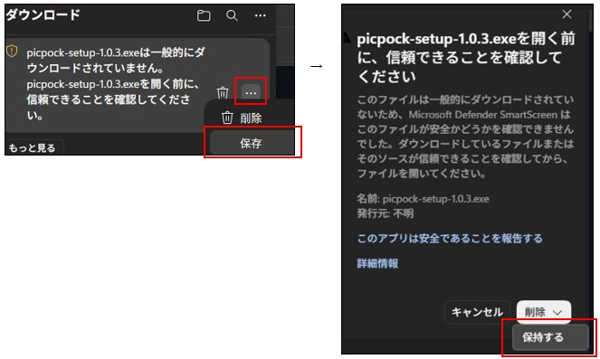
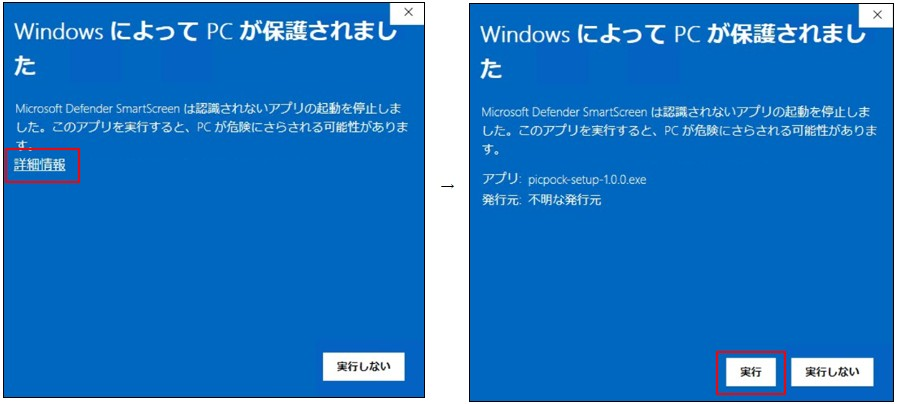
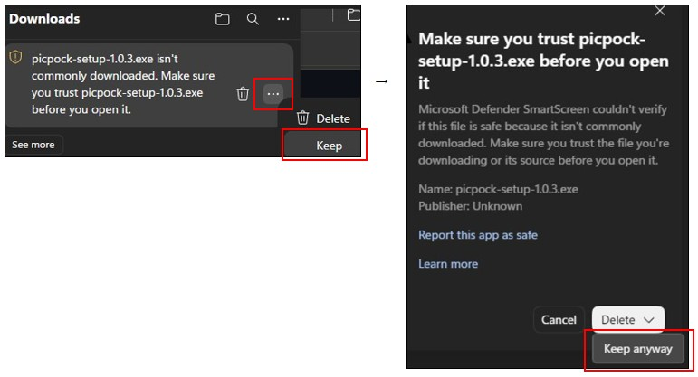
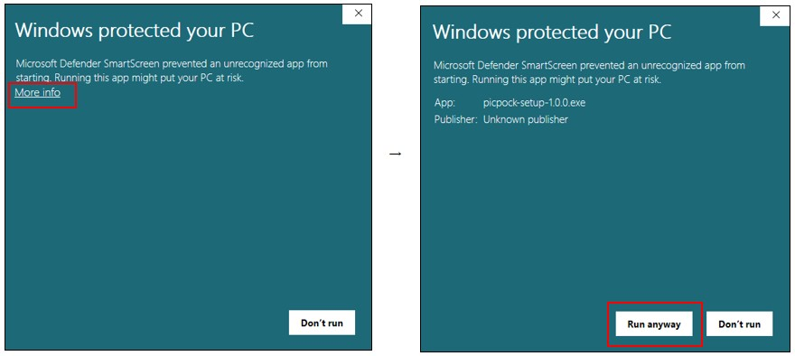

# Install PicPock on Windows
### [日本語](#japanese) | [English](#english) 

## ＜日本語＞

### インストール
1. インストーラーをダウンロードして実行してください。

2. Microsoft Edge を使用している場合、ダウンロード時に「一般的にダウンロードされていません。」という警告が表示されることがあります。  
これは、インストーラーがリリース直後のため、Microsoft Edge / SmartScreen の「ダウンロード実績」が十分でないことが原因です。（マルウェア等の不具合ではありません）。  
もし警告が表示された場合は、以下の手順でダウンロードを行ってください。

- 警告の右側にある **「…」** メニューをクリックし、**「保存」** を選択します。

- **「保持する」** をクリックすると、通常通りダウンロードが完了します。  

3. 本アプリは個人開発のためデジタル署名を行っておらず、インストール時にWindows SmartScreenの警告が表示されることがあります。以下の手順で回避が可能です。

  - 青い画面が表示されたら 「詳細情報」 をクリックします。

  - 右下に表示される 「実行」 ボタンをクリックすると、インストールが開始されます。

---

### アンインストール
- OS標準のアプリの削除画面からアンインストールを実行してください。

## ＜English＞

### Installation
1. Download and run the installer.

2. When downloading the app installer using Microsoft Edge, you may see a warning saying "[filename] isn't commonly downloaded."  
This occurs because the installer is a recent release and does not yet have enough download history with Microsoft Edge / SmartScreen.  (Rest assured, this is not due to malware or a security issue.)    
 If this warning appears, please follow these steps to complete the download:

 - Click the "..." (More options) menu next to the warning and select "Keep".

 - Then select "Keep anyway" to complete the download.

3. As this is an independently developed app without a digital signature, a Windows SmartScreen warning may appear. You can proceed by following these steps:

- Click "More info" on the blue warning screen.

- Click the "Run anyway" button that appears at the bottom right to start the installation.

---

### Uninstallation
Use the standard OS application removal process.

---

### [👉 TOP Page](./README.md)

