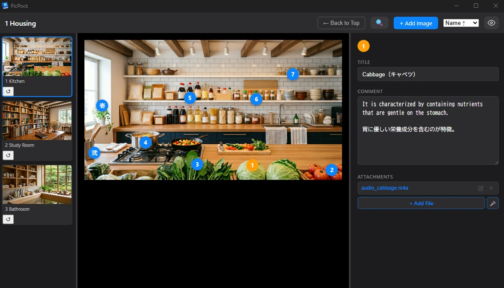

# PicPock (Picture in your pocket)
### [日本語](#japanese) | [English](#english) 

## Website 
### (日本語)　https://picpock.net
### (English)　https://picpock.net/en

## ＜日本語＞

### PicPockとは
PicPock（ピックポック）は、あなただけのお気に入りのピクチャーディクショナリー（絵辞典）が作れる、どなたでも無料でご利用いただけるフリーソフトウェアです。

--- 

### 動作環境
- 本アプリはオフラインで動作可能です。インターネット接続は不要です。
- データは、設定画面で指定したフォルダー内に保存されます。
- 複数デバイス間でデータを同期したい場合は、クラウド同期フォルダー（Dropbox、OneDrive など）をご利用ください。

--- 

### 対応OS
- **Windows**: Windows 10 / 11 (64bit)
- **macOS**: macOS 14 Sonoma 以降

---

## ダウンロード
### [👉 Download PicPock](https://github.com/s-uzumaki/PicPock-App/releases/latest)

| プラットフォーム | ダウンロードファイル |
| --- | --- | 
| Windows | picpock-setup-X.X.X.exe |
| Mac (Apple Silicon) | PicPock-X.X.X-arm64.dmg |
| Mac (Intel) | PicPock-X.X.X-x64.dmg |

---

### インストール
#### ＜Windows＞
- [インストール手順（Windows）](./Install_windows.md)

#### ＜Mac＞
- [インストール手順（macOS 15 Sequoia 以降）](./Install_mac_Sequoia.md)
- [インストール手順（macOS 14 Sonoma 以前）](./Install_mac_Sonoma.md)

---

### 免責事項

本アプリは現状有姿（"as is"）で提供されます。
開発者は以下について一切の責任を負いません。

- 本アプリの使用・使用不能によって生じた損害
- データの消失・破損・文字化け等
- OS・ハードウェアの変更による動作不具合
- 第三者によるアクセスや情報漏えい

バックアップは利用者ご自身で行ってください。

## ＜English＞

### What is PicPock?
PicPock is free software that allows anyone to create their own personalized picture dictionary.

---

### Key Features & Environment
- Offline Capability: This application works entirely offline. No internet connection is required.

- Data Storage: Data is stored within a folder specified in the settings screen.

- Cloud Sync: To sync data across multiple devices, please use a cloud-integrated folder (such as Dropbox or OneDrive).

--- 

### Supported OS
- **Windows**: Windows 10 / 11 (64-bit)
- **macOS**: macOS 14 Sonoma or later

---

## Download
### [👉 Download PicPock](https://github.com/s-uzumaki/PicPock-App/releases/latest)

| Platform | Download File |
| --- | --- | 
| Windows | picpock-setup-X.X.X.exe |
| Mac (Apple Silicon) | PicPock-X.X.X-arm64.dmg |
| Mac (Intel) | PicPock-X.X.X-x64.dmg |

--- 

### Installation
#### ＜Windows＞
- [Installation guide (Windows)](./Install_windows.md)

#### ＜Mac＞
- [Installation guide (macOS 15 Sequoia or later)](./Install_mac_Sequoia.md)
- [Installation guide (macOS 14 Sonoma or earlier)](./Install_mac_Sonoma.md)

---

### Disclaimer

This application is provided "as is" without warranty of any kind.
The developer assumes no responsibility for:

- Any damages arising from the use or inability to use this application
- Loss, corruption, or garbling of data
- Malfunctions caused by OS or hardware changes
- Unauthorized access or information leakage by third parties

Please make sure to back up your data regularly.
